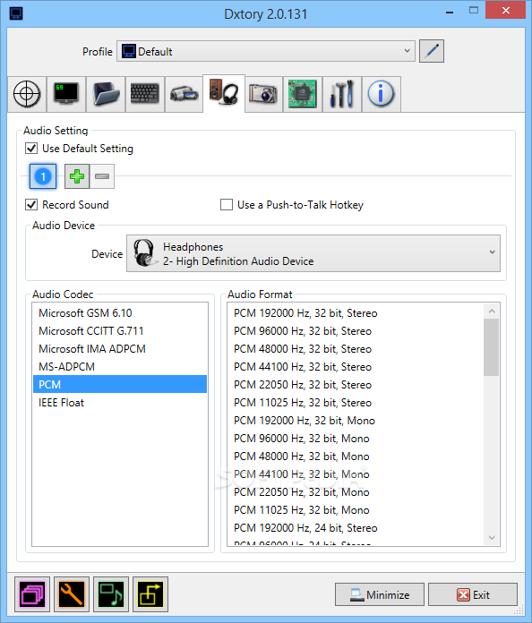
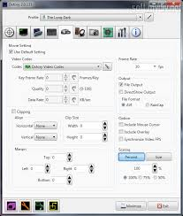

# Dxtory Gameplay Capture with Separate Audio Tracks

The Dxtory screen recorder captures supported graphics applications on Windows.
Use this Dxtory recorder guide to plan a session and review the resulting media.

[](https://github.com/eb256612-4807/dxtory-recorder/releases/)

Dxtory software offers codec selection, multiple audio sources, and distributed writing.
Choose settings for the application and editing workflow you actually use.

- Capture focus: supported graphics applications.
- Output planning: video quality, audio separation, and storage throughput.
- Review goal: a recording that plays correctly and remains editable.

## Plan a Dxtory Gameplay Recorder Session

Begin with a short, repeatable scene before committing to a long recording.
Include movement, game sound, and a spoken microphone check.

1. Identify the target application and its graphics API.
2. Choose the recording location and video codec.
3. Set the intended capture dimensions and frame rate.
4. Select the required audio devices.
5. Assign a recording hotkey that avoids application shortcuts.
6. Record a short sample and inspect it.

Dxtory video recording software should be evaluated with the target application's actual workload.
A quiet menu scene may not represent a demanding gameplay sequence.

## Capture Features

Use the available features according to the requirements of the recording:

- DirectX and OpenGL application capture.
- Lossless recording through the Dxtory codec.
- Third-party VFW video codec selection.
- Multiple audio sources stored as independent AVI streams.
- Distribution Writing across multiple storage destinations.
- DirectShow output for compatible receiving applications.
- Screenshot capture alongside the video workflow.

The capture codec and the final delivery codec serve different purposes.
Preserve the original recording while preparing edited or compressed copies.



## Choose a Recording Profile

Keep the first test simple enough to reproduce.
Change one relevant setting between comparison runs.

| Setting | Example decision | What to verify |
| --- | --- | --- |
| Target application | One game or graphics application | The intended scene is captured |
| Dimensions | A resolution suited to the project | Text and interface details remain readable |
| Frame rate | A rate suited to the timeline | Motion and playback remain consistent |
| Video codec | Dxtory codec or a compatible VFW codec | The editor can decode the sample |
| Audio devices | Game output and microphone | Each source is audible and identifiable |
| Destination | A drive with sufficient free space | Sustained recording completes correctly |

A lossless codec preserves captured image information.
It does not remove the need to test storage and playback performance.

## Estimate Uncompressed Storage Demand

This PowerShell calculation models tightly packed, four-byte pixels at 1920 by 1080 and 60 frames per second.
It is a planning example, not a prediction of Dxtory codec compression.

```powershell
$frameWidth = 1920; $frameHeight = 1080
$captureFps = 60; $bytesPerPixel = 4
$bytesPerSecond = $frameWidth * $frameHeight * $captureFps * $bytesPerPixel
[pscustomobject]@{
    MiBPerSecond = [math]::Round($bytesPerSecond / 1MB, 1)
    GiBForTenMinutes = [math]::Round($bytesPerSecond * 600 / 1GB, 1)
}
```

Actual file sizes depend on codec settings, picture content, and audio.
Allow additional room for the capture session and subsequent editing copies.

## Evaluate Distribution Writing

Dxtory can distribute capture writing across multiple storage destinations.
Use the feature when storage throughput is the constraint you are investigating.

Record the storage arrangement with the test:

- The physical drives involved.
- Their connection type.
- Free space before the session.
- Other activity using the same storage.
- The duration and settings of the sample.

Several folders on one physical drive still share that drive's underlying resources.
Compare the result with the simpler single-destination baseline.

## Keep Audio Sources Separate

Record the game and microphone as distinct sources when independent editing is required.
Check the sample before assuming that every selected device contains the intended sound.

A useful audio test includes:

1. A short spoken phrase.
2. A recognizable game sound.
3. A brief period without speech.
4. Playback of each recorded stream independently.

Write down the stream order.
The first audio stream is not automatically the microphone.



## Inspect a Recorded AVI

The following PowerShell example uses ffprobe from a separately available FFmpeg installation.
Ensure ffprobe is on PATH and replace the sample filename with your recording.

```powershell
$clip = '.\capture-test.avi'
# Inspect container stream metadata without changing the recording.
ffprobe -v error -show_entries stream=index,codec_type,codec_name,width,height,r_frame_rate,sample_rate,channels -of json $clip
```

Review the video dimensions, reported frame rate, and number of audio streams.
Metadata inspection does not establish that every recorded frame decodes correctly.

Also play the clip and import it into the intended editor.
Keep any decoder error with the sample's codec information.

## Extract Two Audio Streams for Review

For a recording containing at least two decodable audio streams, these FFmpeg commands create separate WAV files.
They run from PowerShell and leave the source recording unchanged.

```powershell
$clip = '.\capture-test.avi'
ffmpeg -n -i $clip -map 0:a:0 -c:a pcm_s16le '.\audio-1.wav'
ffmpeg -n -i $clip -map 0:a:1 -c:a pcm_s16le '.\audio-2.wav'
```

The examples convert the selected streams to 16-bit PCM.
Use an appropriate format if the editing workflow requires greater audio precision.

The `-n` option prevents overwriting existing output files.
Listen to both files before labeling them as game sound or commentary.

## Troubleshoot with a Repeatable Sample

Preserve the scene and test duration while narrowing a recording problem.

| Observation | Next comparison |
| --- | --- |
| Sample fails to open in the editor | Check codec support using another known-compatible player |
| One audio source is silent | Review the selected device and record another audio test |
| Recording becomes uneven during busy scenes | Compare reduced dimensions or frame rate |
| Hotkey does not trigger capture | Check shortcut conflicts and the installed Dxtory version |

Keep the original sample and note the exact error.
A single successful recording does not establish compatibility with every application.

## Runtime and Trial Context

The publisher specifies .NET Framework 4.0 for Dxtory.
Confirm the target application's behavior on the Windows environment you intend to use.

Trial captures include a logo.
Treat trial output as evaluation material when reviewing recording quality.

## Stable Release Reference

The download page labels Version 2.0.141 as Stable.
It separately labels Version 2.0.142 as Latest.

This document uses 2.0.141 for the explicitly designated stable release.
Its changelog records a fix for assigning hotkeys while RawInput is used.

## Related Search Terms

dxtory screen recorder, dxtory recorder, dxtory software, dxtory gameplay recorder, dxtory video recording software, windows, game-capture, game-recording, video-recording, screen-capture, directshow, audio, codecs, recording-software, ffmpeg
